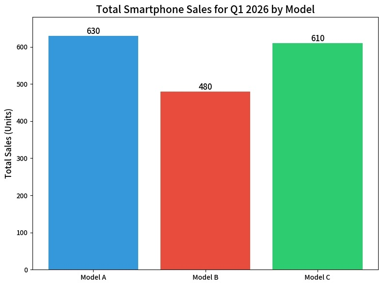
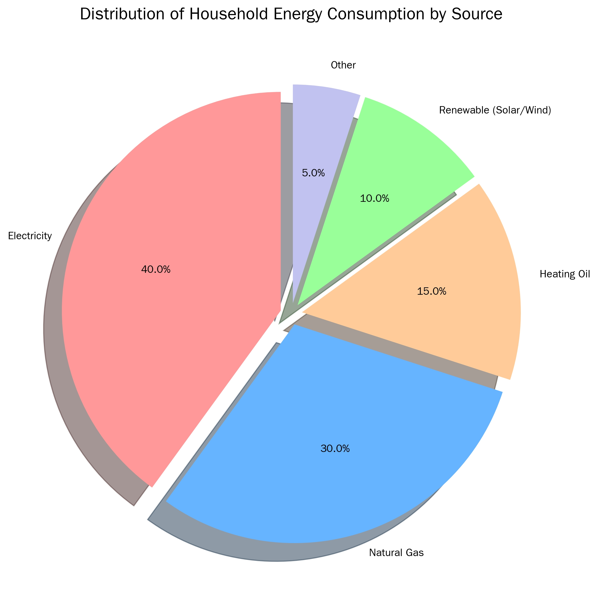
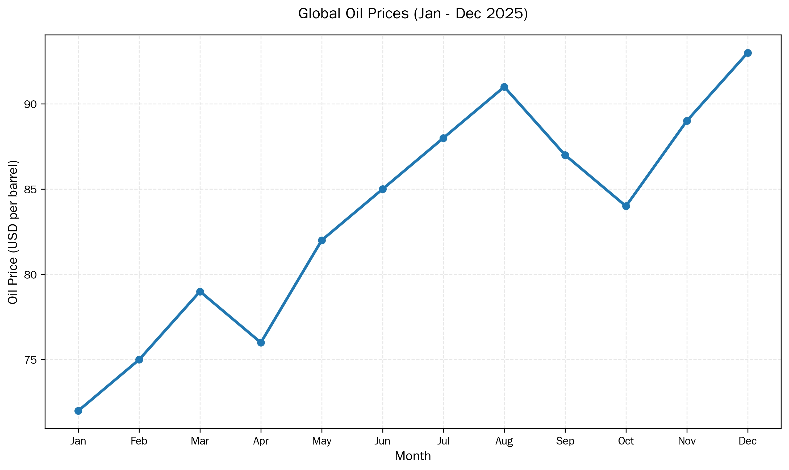
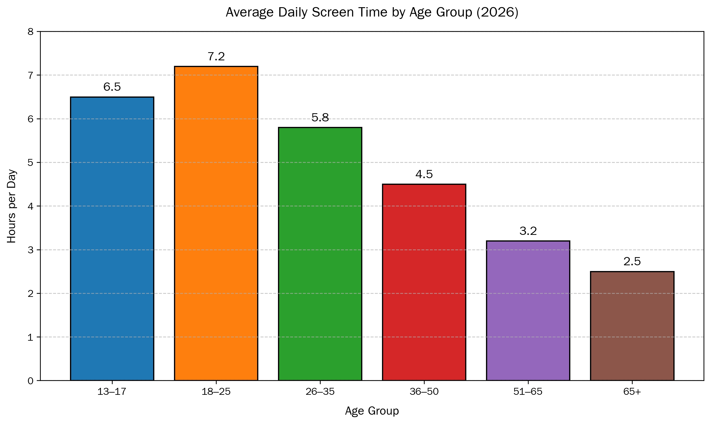

# 数据分析报告

- [三种图表](#三种图表)
  - [柱状图](#柱状图)
  - [饼图](#饼图)
  - [折线图](#折线图)
- [报告的三段结构](#报告的三段结构)
  - [引言](#引言)
  - [概述](#概述)
  - [细节分析](#细节分析)
  - [过渡词](#过渡词)
- [语言要点](#语言要点)
  - [描述趋势的动词](#描述趋势的动词)
  - [描述幅度的副词](#描述幅度的副词)
  - [比较结构](#比较结构)
  - [比例的表达](#比例的表达)
  - [句子开头](#句子开头)
- [例文](#例文)
- [屏幕时间报告的三版](#屏幕时间报告的三版)
- [写作步骤](#写作步骤)

## 三种图表

数据分析报告先说图, 再说文
图表决定能看出什么, 文字只负责把看到的说清
表4-1 是三种常用图表的用途

表4-1 三种图表的用途

| 图表 | 显示什么 | 适用场合 |
| --- | --- | --- |
| 柱状图 bar chart | 不同类别的数量对比 | 各产品销量, 各班人数, 调查结果 |
| 饼图 pie chart | 各部分占整体的比例 | 收入来源, 预算分配, 市场份额 |
| 折线图 line graph | 随时间变化的趋势 | 股价, 气温, 月度增长 |

### 柱状图

柱状图用高低不同的矩形比较离散的类别
读图先看三件事: 排名, 总量, 差距

图4-1 三部手机第一季度的销量

三部手机的总量分别是 630, 610, 480 台
Model A 最高, 比 Model C 多 20 台
Model B 落后明显, 与其他两款不在同一量级

同一组数字按月份拆开, 读法就变了
Model A 三月卖得最好, Model C 一月卖得最好
这时比较的是趋势, 不是总量

### 饼图

饼图把一个整体切成若干扇区, 每区一个比例
读图看两件事: 占比与排序

图4-2 家庭能源消费的构成

电占 40%, 天然气 30%, 取暖油 15%
可再生能源 10%, 其他 5%

两件事必须交代: 各项的份额, 以及谁最大谁最小
比例加起来要等于百分之百, 否则数据有问题

### 折线图

折线图把数据点连成线, 显示一段时间的走势
读图看三件事: 总趋势, 阶段变化, 极值点

图4-3 2025 年国际油价的走势

整体是上行, 中间有若干次波动
三月到四月有一次小幅回落
一月最低, 十二月最高
上半年稳步上涨, 下半年先跌后急升

写折线图常犯的错是只写开头与结尾
中间每一次转折都是信息, 该给的阶段要给出

## 报告的三段结构

数据分析报告只有三段
表4-2 列出各自的任务

表4-2 报告的三个部分

| 部分 | 写什么 | 作用 |
| --- | --- | --- |
| Introduction | 数据, 时间范围, 背景, 方法 | 交代分析的边界 |
| Overview | 最显著的发现 | 先给结论 |
| Detailed Analysis | 具体数字与对比 | 用数据支撑结论 |

### 引言

引言交代四件事
分析的是什么数据, 覆盖哪段时间, 用什么图表, 用什么方法

例4-1: 引言句
This bar chart presents an analysis of the sales
performance of Product A, B, and C for the first
quarter of 2026.

一句里四个要素齐全
data 是产品 A 与 B 的销量, time frame 是第一季度
context 是柱状图, methodology 是比较

### 概述

概述给大图景, 不展开数字
要写的是主趋势, 最突出的对比, 以及例外

例4-2: 概述句
Overall, Product A showed the strongest sales
performance with steady growth. Product C declined
in March, while B remained stable.

三句话给了趋势, 下降了谁, 谁没动
一个数字都没有, 读者已经知道结论

### 细节分析

细节分析用数字支撑概述
每个结论都要有出处, 并指出图表编号

例4-3: 细节句
Product A achieved USD 50k in sales, nearly double
Product B's USD 26k and five times Product C's USD 9k,
as shown in Figure 1.

数字后跟比较, 比较后跟出处
读者可以顺着图表核对

### 过渡词

段与段之间靠过渡词衔接
表4-3 是两类常用表达

表4-3 报告中的过渡词

| 用途 | 表达 |
| --- | --- |
| 引出总体发现 | In summary, To summarize, In essence, At a glance |
| 转入具体数据 | Specifically, A closer look at the data reveals that |

## 语言要点

### 描述趋势的动词

表4-4 趋势动词

| 方向 | 动词 | 例句 |
| --- | --- | --- |
| 上升 | increase, rise, grow, soar, surge, peak | Sales increased steadily. |
| 下降 | decrease, fall, drop, decline, plunge | Profits fell sharply in Q3. |
| 平稳 | remain stable, level off, plateau out | The price remained stable for six months. |
| 波动 | fluctuate, vary, go up and down | Stock prices fluctuated wildly. |

soar 与 surge 幅度大, plummet 表示暴跌
选词要跟图上折线的陡峭程度对应

### 描述幅度的副词

表4-5 幅度副词

| 幅度 | 副词 | 例句 |
| --- | --- | --- |
| 大 | dramatically, significantly, sharply, wildly | Expenses increased dramatically. |
| 中 | steadily, gradually, moderately, consistently | Production gradually increased. |
| 小 | slightly, marginally, minimally, subtly | Costs slightly decreased in Q4. |

动词定方向, 副词定程度
两句都说下降, 加 sharply 与加 slightly 是两件事

### 比较结构

表4-6 三种比较结构

| 结构 | 例句 |
| --- | --- |
| 比较级 | Product A is more popular than Product B. |
| 最高级 | Product C was the least profitable item. |
| 倍数 | Sales in Q1 were twice as high as Q2. |

倍数的说法要统一
twice the length of, twice as long as, twice that of
twice longer than 语义含糊, 尽量不用

### 比例的表达

表4-7 比例的三种写法

| 用途 | 表达 | 例句 |
| --- | --- | --- |
| 多数与少数 | the majority of, a large proportion of | The majority of the budget (60%) went to marketing. |
| 精确百分比 | account for, constitute, represent | Online sales account for 35% of revenue. |
| 最大与最小份额 | the largest share, the smallest fraction | Food costs are the largest share of expenses. |

### 句子开头

表4-8 段首句的开头

| 用途 | 开头 |
| --- | --- |
| 指图表 | As can be seen from the chart... |
| 指数据 | According to the data... |
| 说总体趋势 | Overall, the trend indicates that... |
| 强调某点 | It is worth noting that... |

两个固定句型也常用
There is a stable increase in ...
Sales experience a great increase in ...

## 例文

例4-4: 第一季度的销售报告
Sales Performance Analysis Report: Q1 2026
This bar chart presents an analysis of the sales
performance of Product A, B, and C for the first
quarter of 2026.
Overall, Product A exhibited the most robust sales
performance, characterized by steady growth
throughout the quarter. In contrast, Product C
experienced a decline in March, and Product B
maintained a stable but moderate sales level.
In detail, Product A achieved sales of USD 50,000,
which was nearly double the USD 26,000 generated by
Product B and five times the USD 9,000 sales of
Product C. This significant gap highlights Product A's
market dominance during this period. While Product B
showed consistency, Product C's decline indicates a
potential area for strategic review.

四段对应四个功能
第一段交代分析对象, 第二段给结论
第三段给数字, 第四段给判断
判断句之前一定有数字, 这是报告的规矩

## 屏幕时间报告的三版

同一张图可以写成三种难度
三版的差别在句式密度与词汇难度

例4-5: 学术版
The bar chart illustrates the average number of hours
spent on screens each day by six different age groups
in the year 2026.
In general, there is an inverse relationship between
age and daily screen time. Young adults and teenagers
have the highest screen usage, and screen time
decreases gradually as age increases.
In detail, people aged between 18 and 25 spend the
most time on screens, at 7.2 hours per day, and the
13-17 age group is the second highest at 6.5 hours.
The figure for the 26-35 age group is noticeably
lower at 5.8 hours. The 36-50 age group spends 4.5
hours daily, followed by 3.2 hours for those aged
51-65. People aged 65 and over have the lowest
screen time, at 2.5 hours per day, which is about
one-third of the peak usage in the youngest group.

图4-4 各年龄段的日均屏幕时间

学术版的特点
用 inverse relationship 概括关系, 不用 very different
用 the figure for 指代前文的数字, 避免重复 hours
极值用 the most 与 the lowest 点明

例4-6: 简化版
The bar chart shows how many hours people of
different ages use screens each day in 2026.
Overall, younger people use screens much more than
older people. As age increases, daily screen time
decreases.
People aged 18-25 use screens the most, at 7.2 hours
per day. Those aged 13-17 are close behind at 6.5
hours. In contrast, people over 65 use screens the
least, at only 2.5 hours a day. After the age of 25,
screen time falls gradually with each older age group.

简化版只用一般现在时与常见词
句子短, 每句一个数字, 适合口语汇报
两版信息相同, 学术版胜在密度, 简化版胜在清楚

## 写作步骤

(1) 读图, 先找最高点, 最低点与交叉点
(2) 写引言, 交代数据, 时间与方法
(3) 写概述, 一到两句, 只讲结论
(4) 写细节, 每段一个发现, 数字紧跟其后
(5) 查数字, 单位, 时间与图表一致