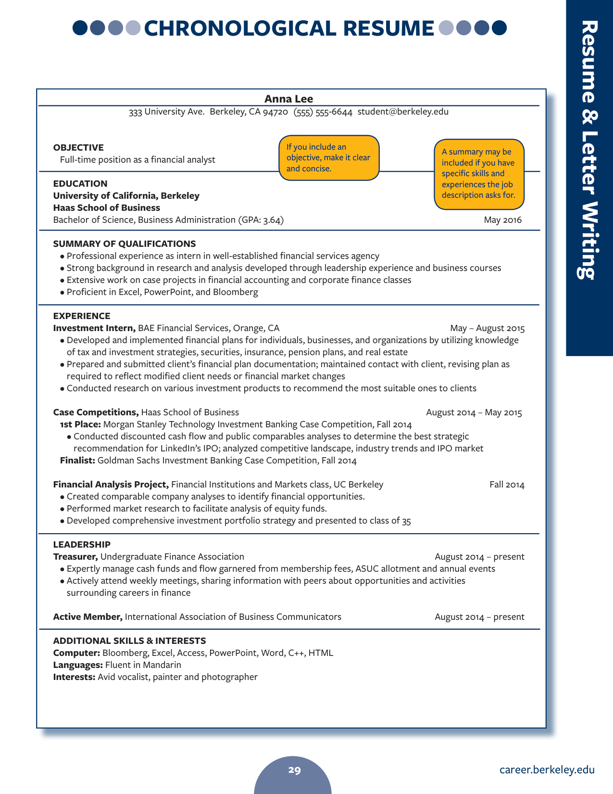
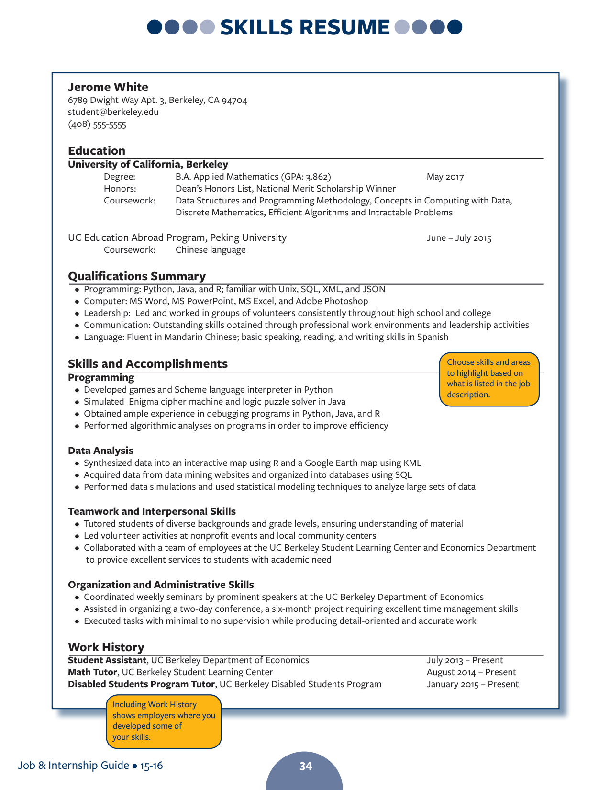
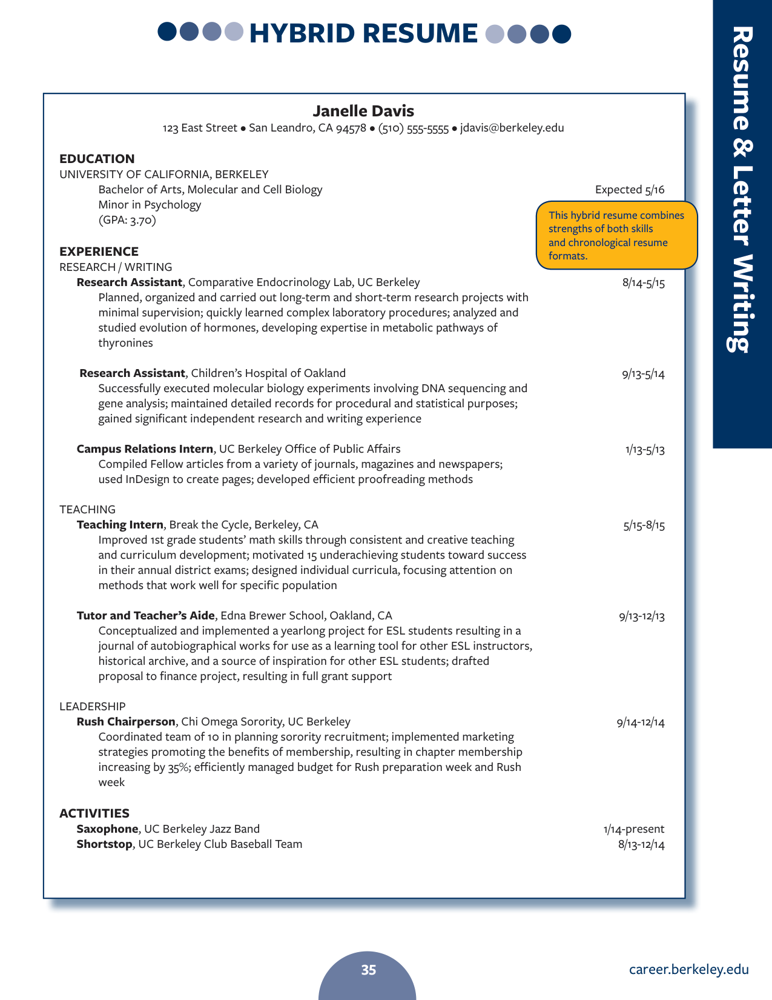

# 简历

- [简历要解决的问题](#简历要解决的问题)
- [三个必写部分](#三个必写部分)
  - [个人信息](#个人信息)
  - [教育背景](#教育背景)
  - [工作与实践经历](#工作与实践经历)
- [选写部分](#选写部分)
- [三种版式](#三种版式)
  - [编年式](#编年式)
  - [技能式](#技能式)
  - [混合式](#混合式)
- [用词与句式](#用词与句式)
  - [每条以动词开头](#每条以动词开头)
  - [写成果不写职责](#写成果不写职责)
  - [用数字说明影响](#用数字说明影响)
- [排版](#排版)
- [提交前的检查](#提交前的检查)

## 简历要解决的问题

雇主读一份简历的时间通常不到一分钟
简历要在这段时间里回答一个问题: 这个人是否值得约见

由此推出三条形式要求
一页, 留白够, 每条只有一行到两行
内容要求: 与目标职位相关, 有具体成果, 数字可核对

课件把简历拆成三个层面
排版管版面与层级, 构成管写哪些板块
格式管每个板块内部怎么排
三个层面分开检查, 一页纸的毛病通常只出在其中一层

## 三个必写部分

表5-1 是简历的三个必写部分

表5-1 简历的必写部分

| 部分 | 写什么 | 常见错误 |
| --- | --- | --- |
| 个人信息 | 姓名, 地址, 电话, 邮箱 | 邮箱名不正式 |
| 教育背景 | 学校, 专业, 学位, 毕业时间 | 从高中写起 |
| 经历 | 职位, 机构, 起止时间, 成果 | 只写职责不写成果 |

### 个人信息

姓名写在最上面, 字号最大
下面一行放地址, 电话与邮箱
电话要带区号, 地址要带邮编

可以加个人主页或 LinkedIn 链接
加了就要保证内容与简历一致, 且适合雇主查看
语音信箱的留言也要算在内

### 教育背景

教育背景给五项
学校, 学院, 专业, 学位, 毕业或预计毕业时间

相关课程可以单列, 与目标职位无关的课程不列
GPA 与荣誉属于选写, 成绩好才写
读过几所学校时, 最近的写在最前
高中经历不必写

### 工作与实践经历

带薪与不带薪的工作都算经历
实习, 助研, 社团, 志愿活动都可以放进这一部分

每条经历给三样东西
职位名称, 机构与地点, 起止时间
下面用两三条说明做了什么, 做成了什么

挑选的标准只有一条: 与目标职位相关
相关性弱的内容删掉, 相关性强的多写两行

## 选写部分

表5-2 是选写部分与它们的适用时机

表5-2 选写部分

| 部分 | 内容 | 什么时候写 |
| --- | --- | --- |
| 求职意向 | 一行, 具体到岗位 | 投递方向明确 |
| 资质概要 | 三到四条, 对应职位描述 | 有直接相关的技能 |
| 语言能力 | fluent, conversational, basic | 应聘涉外岗位 |
| 活动与兴趣 | 倒序, 含领导经历 | 应届生缺工作经历 |
| 荣誉 | Dean's List, 奖学金 | 有可写的荣誉 |
| 研究与发表 | 论文, 报告, 项目 | 申请研究型岗位 |
| 课程项目 | 与目标职位相关的课设 | 应届生 |
| 推荐人 | 单列一页, 用前征得同意 | 雇主索要时 |

求职意向要具体
Full-time position as a financial analyst 胜过
Seeking a challenging job
一行写完, 不写形容词

活动与兴趣按时间倒序
有领导职务的写领导职务, 只写参与的不如不写
兴趣栏可以留, 但要能撑起一次简短交谈

推荐人不必在简历上写 References available on request
雇主索要时另附一页
写谁的名字之前必须先征得本人同意
亲属与朋友不能作推荐人

资质概要用形容词短语, 不用完整句
proficient in data analysis, excellent in teamwork
familiar with Python and R
每条对准职位描述里的一句要求, 写三到四条

语言能力分三档, 说法固定
Proficient in English 是能用作工作语言
Fluent in German 是能流畅交流
Able to speak and write in Spanish 是能应付日常
不写 good at English 这类含糊说法

## 三种版式

### 编年式

编年式按时间倒序列经历
教育, 经历, 活动, 技能依次排下来

图5-1 编年式简历

编年式适合经历与目标职位方向一致的人
雇主一眼就能看出成长路径

### 技能式

技能式按能力分类, 每类下面举经历
分类名可以是 Programming, Data Analysis, Teamwork

图5-2 技能式简历

技能式适合转行或经历零散的人
雇主的注意力被引到能力上, 而不是时间线
技能不只来自正式工作, 日常练习, 培训, 自学都算来源

### 混合式

混合式先给几个技能块, 块内仍按时间倒序
研究方向, 写作, 教学, 领导各成一块

图5-3 混合式简历

混合式适合同时有研究与实务经历的人
混合式与技能式的区别在依据: 技能式的每条能力可以不挂经历
混合式的每条能力后面必须紧跟具体经历, 且经历按时间倒序

表5-3 三种版式的比较

| 版式 | 排列依据 | 适合的人 |
| --- | --- | --- |
| 编年式 | 时间倒序 | 经历与目标职位一致 |
| 技能式 | 能力分类 | 转行, 经历零散 |
| 混合式 | 先分类, 类内倒序 | 研究与实务兼有 |

## 用词与句式

### 每条以动词开头

简历不写完整句子, 省略主语 I
每条从动词开始, 时态与经历是否结束对应

表5-4 简历常用动词

| 类别 | 动词 |
| --- | --- |
| 管理 | manage, coordinate, direct, supervise |
| 创建 | design, develop, create, establish, initiate |
| 分析 | analyze, evaluate, research, assess |
| 沟通 | present, negotiate, train, publish |

现在仍担任的职位用现在时
已经结束的职位用过去时
同一份简历里时态不能混

### 写成果不写职责

职责说明岗位, 成果说明能力
招聘方要的是后者

表5-5 同一件事的三种写法

| 写法 | 例句 | 问题 |
| --- | --- | --- |
| 只写职责 | Responsible for social media accounts | 没有结果 |
| 写动作 | Managed a Facebook page | 有动作无影响 |
| 写影响 | Improved page viewership by 14% | 可核对 |

Responsible for 开头是简历里最常见的浪费
它占了位置, 却没告诉读者任何结果

例5-1: 三条成果式条目
Improved monthly Facebook page viewership by 14%
Planned a spring conference attended by over 300 students
Trained new employees to use machines and serve customers

三条都以动词开头
每条给一个可核对的对象与数字

### 用数字说明影响

数字让成果变得可信
凡是能计数的都写出来

表5-6 可以量化的几类内容

| 类别 | 例子 |
| --- | --- |
| 规模 | over 300 students, a team of five |
| 增幅 | by 14%, by 35% |
| 覆盖 | 57 faculty and 11 staff |
| 排名 | 1st place, finalist |

数字必须真实
写进简历的每个数字都要能在面试时说清来源

## 排版

表5-7 排版要求

| 项目 | 要求 |
| --- | --- |
| 长度 | 一页, 应届生不加页 |
| 板块数 | 五到六个, 多了显得散 |
| 标题样式 | 同级标题的字体, 字号, 粗细, 对齐全一致 |
| 正文层级 | 每一级内部的格式一致 |
| 项目符号 | 全部左对齐, 缩进相同 |
| 日期 | 全部右对齐 |
| 字体 | Times New Roman 或 Arial, 全篇一种 |
| 字号 | 正文五号, 即 10.5 磅, 标题略大 |
| 强调 | 只用字号与位置, 不用彩色 |
| 文件 | 导出 PDF, 文件名含姓名与岗位 |

日期右对齐是最容易被漏掉的一条
右对齐以后, 时间列成为一条竖直的参照线, 读者扫视更快
标题样式不一致则相反, 读者会以为换了层级

## 提交前的检查

(1) 电话与邮箱逐个字符核对
(2) 时间全部倒序, 没有重叠
(3) 每条以动词开头, 时态一致
(4) 每条至少一个具体对象, 尽量带数字
(5) 与职位描述逐条对照, 关键词都出现
(6) 没有 Responsible for, 没有 I
(7) 板块五到六个, 没有多余的分节
(8) 同级标题样式统一, 日期全部右对齐
(9) 全篇一种字体, 正文五号
(10) 打印一份, 检查断行与孤行