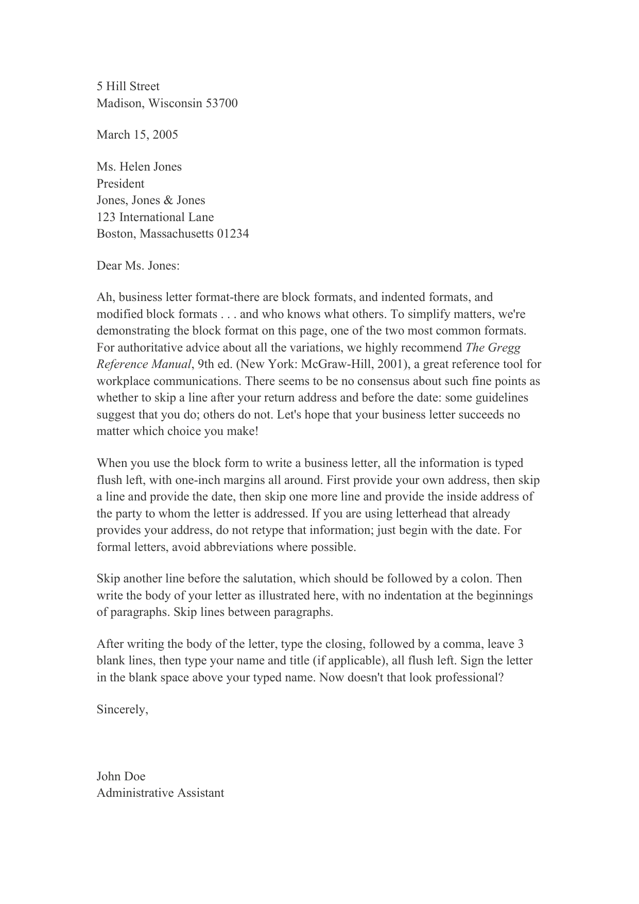
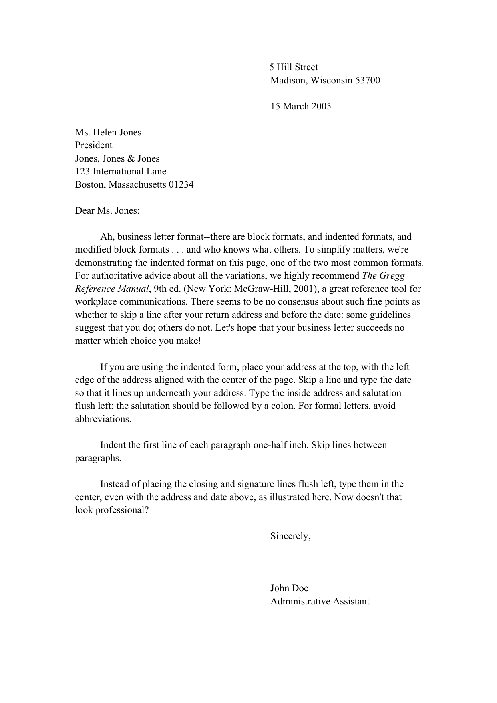

# 商务信函与求职信

- [两种版式](#两种版式)
  - [齐头式](#齐头式)
  - [缩进式](#缩进式)
  - [七个组成部分](#七个组成部分)
- [称呼与敬语](#称呼与敬语)
- [正文的三段](#正文的三段)
  - [排序练习的方法](#排序练习的方法)
- [求职信](#求职信)
  - [求职信与简历的分工](#求职信与简历的分工)
  - [三个段落](#三个段落)
  - [常见问题](#常见问题)
- [提交前的检查](#提交前的检查)

## 两种版式

商务信函有两种常见版式: 齐头式与缩进式
两者的差别只在位置, 内容与语气完全相同

### 齐头式

齐头式把全部内容左对齐, 四周留一英寸边距

顺序是: 发件人地址, 空一行, 日期, 空一行, 收件人地址
用印有地址的信头纸时, 直接从日期开始
空一行写称呼, 称呼后跟冒号
正文段首不缩进, 段与段之间空一行
结尾敬语后跟逗号, 空三行打姓名与职务, 全部左对齐
签名写在空出的三行里

图6-1 齐头式信函

### 缩进式

缩进式把地址与日期放在页面上方靠中的位置

发件人地址的左边缘与页面中线对齐
空一行写日期, 与地址左对齐
收件人地址与称呼左对齐, 称呼后跟冒号
每段首行缩进半英寸, 段与段之间空一行
结尾敬语与署名居中, 与上面的地址日期对齐

图6-2 缩进式信函

表6-1 两种版式的差别

| 项目 | 齐头式 | 缩进式 |
| --- | --- | --- |
| 地址与日期 | 左对齐 | 靠中 |
| 段首 | 不缩进 | 缩进半英寸 |
| 敬语与署名 | 左对齐 | 居中 |
| 适用 | 通用 | 传统正式场合 |

### 七个组成部分

表6-2 信函的组成部分

| 部分 | 内容 | 要求 |
| --- | --- | --- |
| 发件人地址 | 门牌, 城市, 州, 邮编 | 有信头纸时省略 |
| 日期 | 月日年或日月年 | 全篇统一 |
| 收件人地址 | 姓名, 职务, 机构, 地址 | 与信封一致 |
| 称呼 | Dear 加姓名 | 后用冒号 |
| 正文 | 三段, 每段一个任务 | 段间空行 |
| 结尾敬语 | Sincerely 等 | 后用逗号 |
| 署名 | 姓名与职务 | 与敬语对齐 |

正式信件尽量不用缩写
日期写全, 月份用英文全称
称呼里的头衔与收件人地址里的写法要一致

例6-1: 齐头式的短函
5 Hill Street
Madison, Wisconsin 53700
March 15, 2025
Ms. Helen Jones
President
Jones, Jones & Jones
123 International Lane
Boston, Massachusetts 01234
Dear Ms. Jones:
Thank you for the materials you sent last week. I have
read the proposal and will reply with comments by the
end of the month.
Sincerely,

John Doe
Administrative Assistant

地址逐行排列, 不加标点
段落之间空一行, 段首不缩进
敬语与姓名之间留出签名的空间

## 称呼与敬语

表6-3 称呼的写法

| 情形 | 写法 |
| --- | --- |
| 知道姓名与性别 | Dear Ms. Jones: |
| 知道姓名, 性别不明 | Dear Robin Lee: |
| 不知姓名 | Dear Sir or Madam: |
| 不确定是否有人读 | To Whom It May Concern: |

表6-4 结尾敬语的写法

| 情形 | 敬语 |
| --- | --- |
| 不知姓名 | Yours faithfully, |
| 知道姓名 | Yours sincerely, |
| 美式通用 | Sincerely, |

美式信件多用 Sincerely
英式信件按是否知道姓名区分 faithfully 与 sincerely
两种体系不要混用, 一封信里只取一套

## 正文的三段

表6-5 正文三段的功能

| 段 | 功能 | 篇幅 |
| --- | --- | --- |
| 第一段 | 说明写信目的 | 一到两句 |
| 第二段 | 给背景, 理由与细节 | 三到五句 |
| 第三段 | 说请求, 下一步与致谢 | 一到两句 |

第一段直接说事
不铺垫, 不寒暄, 读者一眼知道这封信要他做什么

第二段给事实
时间, 地点, 数量, 相关的人与事

第三段给动作
请对方回复, 确认, 或者说明自己下一步做什么
结尾一句致谢, 一句话即可

例6-2: 会议后的跟进信
Dear Ms. Abdin,
We met at the Corporate Strategy meeting last month, but
I didn't get a chance to give you a business card and ask
if you are willing to join my career network.
I am writing today to send you all my contact
information, including my business card, because I think
it could be mutually beneficial to share this information
with you.
While we work in different areas of the organization, I
felt the rapport we shared was so strong that we should
keep in contact, possibly work together on a future
endeavor.
Thanks for your time. I look forward to hearing back
with your contact information, and your acceptance into
my network of contacts.
Sincerely,
Scott Morris

四段对应四个动作
先提见面的场合, 再说写信目的, 然后给理由, 最后说期待
全文没有一句客套的空话

### 排序练习的方法

把一封信拆成片段再排序, 是检查版式最快的方法
判断顺序靠四条线索

(1) 发件人地址在最上, 收件人地址在日期之后
(2) 日期夹在两组地址之间
(3) 称呼之后才是正文
(4) 敬语与署名在最后

## 求职信

### 求职信与简历的分工

简历列事实, 求职信解释这些事实为什么对这份工作有用
两者的内容要对应, 但不能互相抄

求职信只写三段到四段, 一页
收件人能读出三件事: 应聘什么岗位, 凭什么合适, 怎么联系

### 三个段落

表6-6 求职信的三段

| 段 | 写什么 | 例子 |
| --- | --- | --- |
| 开头 | 岗位, 信息来源, 附件 | advertised in the Times Union |
| 中间 | 两三条匹配的资历, 带事实 | 3 years of experience |
| 结尾 | 联系方式, 请求面试, 致谢 | available for an interview |

开头点名岗位与来源
写明随信附上什么, 申请表, 证书, 简历, 推荐人

中间段给两三条与岗位对应的资历
每条一句, 用具体事实支撑, 不写形容词

结尾给联系方式, 说明随时可以面试, 最后致谢

例6-3: 求职信的开头
Dear Mr. Gilhooley,
I am writing to apply for the programmer position
advertised in the Times Union. As requested, I am
enclosing a completed job application, my certification,
my resume, and three references.

例6-4: 求职信的中间段
I have a total of 3 years of work experience in this
field. My present position has taught me the importance
of clear communication and customer service over the
phone. In my current role I resolve customer problems,
give sales pitches and take accurate notes of
conversations with customers.

两段都没有空话
开头给岗位与附件, 中间给年限, 职责与可验证的行为

### 常见问题

表6-7 求职信的常见问题

| 问题 | 改法 |
| --- | --- |
| 通篇形容词 | 换成事实与数字 |
| 复述简历 | 只挑与岗位对应的两三条 |
| 不提岗位名称 | 开头点名岗位与来源 |
| 结尾无联系方式 | 给邮箱与电话 |
| 称呼写 Dear Sir | 尽量查到收件人姓名 |

## 提交前的检查

(1) 版式全篇一致, 不混用齐头与缩进
(2) 三组信息齐全: 发件人, 日期, 收件人
(3) 称呼与敬语配套, 冒号与逗号没有写反
(4) 正文三段, 每段一个任务
(5) 附件在信里点明, 与寄出的文件一致
(6) 姓名, 机构, 日期逐字核对